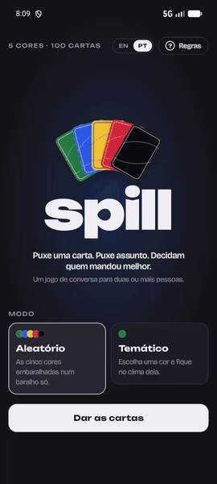
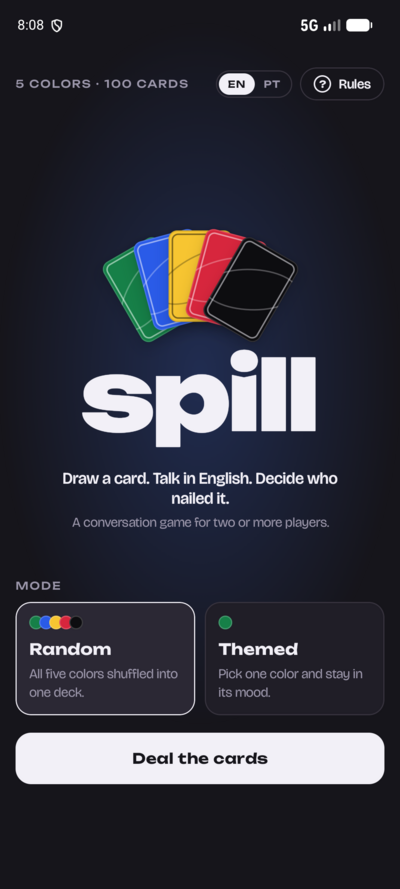
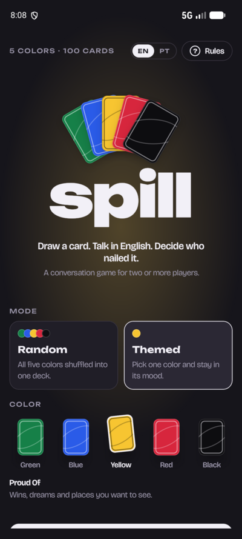
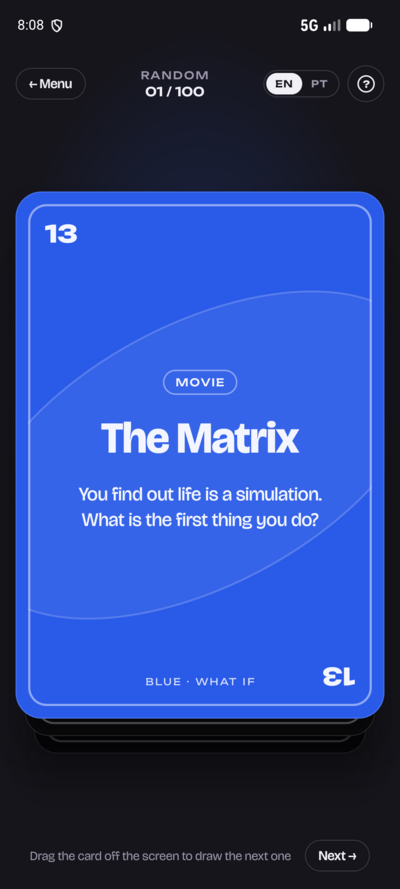
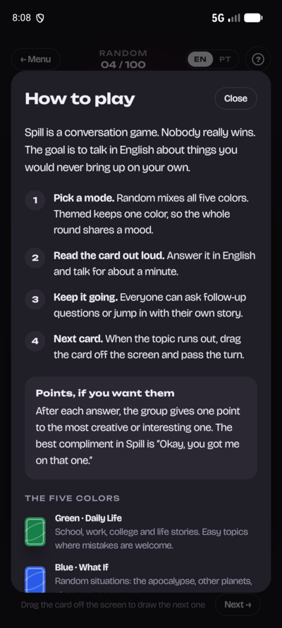
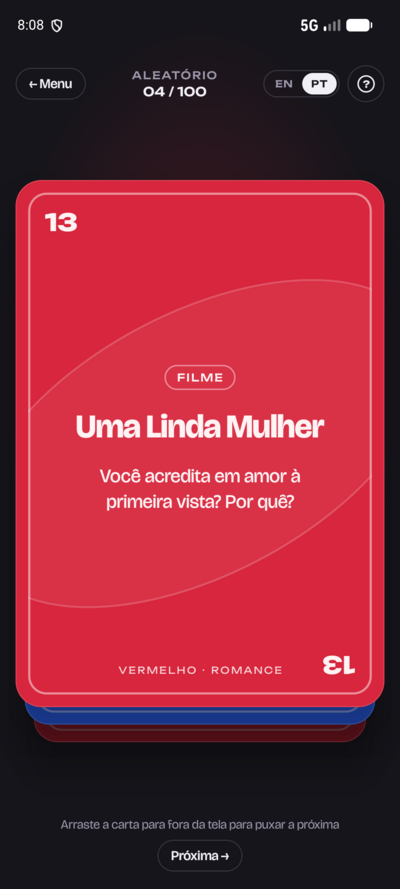

# Spill

[](https://github.com/PirataZang/Spill/actions/workflows/build.yml)
[](LICENSE)

Um app de cartas para a roda de amigos, feito como **Android nativo** (Kotlin + Jetpack Compose). Tem dois lados:

- **Spill**, um jogo de **conversa** para duas ou mais pessoas: puxe uma carta, responda em voz alta e a roda decide quem mandou melhor.
- **Modo Drink +18**, com **5 jogos de shot**: Desafio, Eu nunca, Faz ou bebe, Paranoia e Mais provável.

<p align="center">
  
</p>

> Vídeo em melhor qualidade: [docs/demo.mp4](docs/demo.mp4)

**Índice:** [Conversa](#spill-o-jogo-de-conversa) · [Jogos de shot](#modo-drink-18-os-jogos-de-shot) · [Adicionar conteúdo](#adicionar-conteúdo) · [Rodar e gerar o APK](#rodar-e-gerar-o-apk) · [Estrutura](#estrutura)

---

## Spill, o jogo de conversa

Ninguém ganha de verdade: a ideia é falar sobre coisas que você nunca puxaria sozinho, em inglês ou em português (troque o idioma no topo da tela).

<p align="center">
  
  
  
  
  
</p>

### Como se joga

1. **Escolha um modo.** *Aleatório* mistura todos os baralhos. *Temático* fica numa cor só, e a rodada inteira tem o mesmo clima.
2. **Leia a carta em voz alta** e fale por mais ou menos um minuto.
3. **Continue a conversa.** Todo mundo pode fazer perguntas ou entrar com a própria história.
4. **Próxima carta.** Arraste a carta para qualquer lado da tela (ou toque em *Próxima*).
5. **Pontos, se quiserem.** Depois de cada resposta, o grupo dá um ponto para a mais criativa.

### Os cinco baralhos (100 cartas)

| Cor | Baralho | Clima |
|---|---|---|
| Verde | Dia a Dia | Escola, trabalho, faculdade, histórias da vida |
| Azul | E Se… | Situações aleatórias: apocalipse, outros planetas, superpoderes |
| Amarelo | Conquistas | Vitórias, sonhos e lugares que você quer conhecer |
| Vermelho | Romance | Amor, primeiros encontros, crushes |
| Preto | Cringe | Momentos vergonhosos, micos e comédia pura |

---

## Modo Drink +18: os jogos de shot

Um segundo jogo dentro do app, **só para maiores de 18**, com visual próprio (fundo escuro e uma cor e um ícone para cada jogo). Antes de abrir ele pede a confirmação de idade, e ninguém é obrigado a responder: é para isso que existe o shot.

### Os 5 jogos

| Jogo | Cor e ícone | Em uma frase |
|---|---|---|
| **Desafio** | preto, garrafa | Responde ou bebe. |
| **Eu nunca** | vinho, copo de shot | Quem já fez, bebe. |
| **Faz ou bebe** | verde, balança | Faz a ação ou bebe. |
| **Paranoia** | azul, espiral | Pergunta secreta, resposta em voz alta. |
| **Mais provável** | amarelo, caveira-interrogação | A roda aponta, o mais votado bebe. |

Existe ainda o **Misturado**, que alterna Desafio e Eu nunca, uma carta de cada.

<p align="center">
  
</p>
<p align="center">
  
</p>

> Arte das cartas, direto do design do app. A tela de jogo as reproduz com o mesmo baralho empilhado do modo de conversa.

### Como cada jogo funciona

**Desafio.** Alguém lê a carta em voz alta e responde. Quem não quiser responder, bebe. Depois vem o **"Para todos"**: a roda inteira responde a uma segunda pergunta, e quem fugir bebe 1 (quem leu a carta bebe 2).

**Eu nunca.** A carta diz algo que alguém pode já ter feito ("Eu nunca… transei no carro"). Quem já fez, assume e bebe. Só uma pessoa bebeu? Ela conta a história ou bebe +1.

**Faz ou bebe.** A carta pede uma ação, como ligar para um contato ou entregar o celular desbloqueado para a roda. Ou você faz, ou bebe. A roda decide se valeu.

**Paranoia.** A pergunta fica escondida. Quem está com o celular **segura a carta** para ler em segredo e responde só com um nome. Se a pessoa citada quiser saber a pergunta, bebe e a carta é revelada para todos ("Bebeu · revelar"); se ninguém quiser saber, é só tocar em "Ninguém bebeu" e passar a carta.

**Mais provável.** "Quem é mais provável de… chorar bêbado?" Conte até 3: todo mundo aponta ao mesmo tempo. O mais apontado bebe. Empate: todos os empatados bebem.

### Quanto se bebe

Cada carta tem de uma a três **caveiras**, que são o nível e valem **1 shot cada**.

| Nível | Nome | Caveiras | Valor | Cartas por jogo |
|---|---|---|---|---|
| 1 | Mico | 1 | 1 shot | 50 |
| 2 | Picante | 2 | 2 shots | 100 |
| 3 | Pesado | 3 | 3 shots | 50 |

São **200 cartas por jogo**, mil no total.

### Monte a rodada

Antes de começar, a tela de configuração deixa você ajustar:

- **Jogo:** uma fila deslizável com os 5 jogos e o Misturado.
- **Níveis:** quais níveis entram (pelo menos um fica sempre ligado).
- **Escalada:** a rodada começa no mico e esquenta até o pesado. Desligada, as cartas vêm embaralhadas.
- **Modo leve:** gole em vez de shot, para a noite durar.

O botão **Começar** mostra quantas cartas a rodada terá. E o botão **?** ao lado do +18, na configuração e dentro de cada jogo, abre o **Como jogar** do jogo escolhido, com o passo a passo e a escala de shots.

> Só para maiores de 18. Beba com responsabilidade e nunca dirija depois de beber.

---

## Adicionar conteúdo

Todo o conteúdo vive em [`app/src/main/assets/catalog`](app/src/main/assets/catalog). **Acrescentar uma pergunta não exige mexer em código Kotlin.**

```
catalog/
├── index.json          # idiomas e ordem dos baralhos de conversa
├── i18n/en.json        # textos da interface, um arquivo por idioma
├── i18n/pt.json
├── decks/green.json    # baralho de conversa: cor, nome por idioma e as cartas
└── drink.json          # Modo Drink: os 5 jogos de shot e os textos das regras
```

### Conversa

**Nova carta:** acrescente um objeto ao array `cards` do baralho. O número da carta é a posição no array.

```json
{
  "kind": "Movie",
  "by": "Opcional: artista, para o tipo Song",
  "en": { "title": "Ratatouille", "prompt": "What dish can you cook well?" },
  "pt": { "title": "Ratatouille", "prompt": "Que prato você sabe fazer bem?" }
}
```

`kind` é uma chave traduzida em `i18n/*.json` (`Movie`, `Series`, `Song`, `Topic`). Para um tipo novo, acrescente a chave em todos os idiomas.

**Novo baralho:** crie `decks/<id>.json` (copie um existente) e liste o `<id>` em `index.json`. A tela inicial, o modo temático e a tela de regras o descobrem sozinhos.

**Novo idioma:** crie `i18n/<codigo>.json`, declare o idioma em `index.json` e traduza `meta` e cada carta nos baralhos.

### Jogos de shot

`drink.json` tem um array por jogo: `dare`, `never`, `doit`, `paranoia` e `likely`. Para acrescentar uma carta, basta um objeto:

```json
{ "level": 2, "main": "Já fingiu orgasmo? Por quê?", "all": "Quanto tempo você aguenta sem sexo? Seja honesto." }
```

- `level`: de 1 a 3 (número de caveiras).
- `main`: o texto da carta. Em *Eu nunca*, completa "Eu nunca…"; em *Mais provável*, completa "Quem é mais provável de…".
- `all`: só no **Desafio**, a pergunta do "Para todos".

Os textos da interface e as regras do *Como jogar* ficam no objeto `ui` do mesmo arquivo. O conteúdo do Modo Drink existe só em português.

### Validação

Os testes rodam no CI e **falham o build** se algo sair do padrão, então nada incompleto chega ao jogador:

- `CatalogTest`: toda carta, baralho e tipo tem texto em todos os idiomas.
- `DrinkTest`: 200 cartas por jogo, na divisão 50/100/50, sem enunciados repetidos, com todos os textos de interface e as regras de cada jogo, e a montagem da rodada (níveis, Escalada e alternância do Misturado).

---

## Rodar e gerar o APK

Requer JDK 21 e Android SDK (compileSdk 37).

```bash
./gradlew testDebugUnitTest   # valida o catálogo e o Modo Drink
./gradlew assembleRelease     # app/build/outputs/apk/release/app-release.apk
./gradlew installDebug        # instala no aparelho/emulador conectado
```

### Build automático (GitHub Actions)

[`.github/workflows/build.yml`](.github/workflows/build.yml) roda em cada push, PR e tag `v*`:

- roda os testes e gera o **`Spill.apk`**, disponível como artefato da execução (`Spill-Android`);
- se os secrets `KEYSTORE_BASE64`, `KEYSTORE_PASSWORD`, `KEY_ALIAS` e `KEY_PASSWORD` existirem, o APK é assinado com a sua chave; sem eles, usa a chave de debug (instala igual, mas não serve para a Play Store). Em tags `v*`, o APK vai anexado à Release.

---

## Estrutura

```
app/src/main/java/app/spill/
├── Catalog.kt        # carrega e valida o catálogo de conversa
├── MainActivity.kt   # ViewModel (estado da rodada, idioma), navegação e brilho ambiente
├── Home.kt           # logo em leque, modos e seleção de cor
├── Logo.kt           # o logo animado
├── Game.kt           # baralho empilhado (DeckStage), arrastar/jogar a carta, fim do baralho
├── Rules.kt          # diálogo de regras do modo de conversa
├── Drink.kt          # catálogo dos jogos de shot e montagem da rodada
├── DrinkUi.kt        # confirmação +18, configuração, cartas, Paranoia e regras
├── DrinkArt.kt       # garrafa, copo, balança, espiral e caveira
└── Ui.kt, Theme.kt   # botões, tipografia e o ornamento das cartas
```

## Licença

[MIT](LICENSE)
