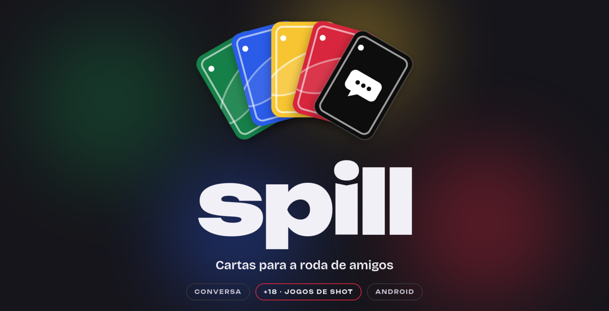
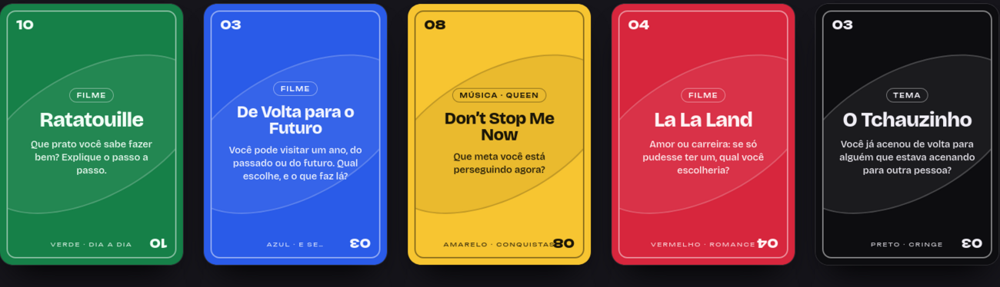
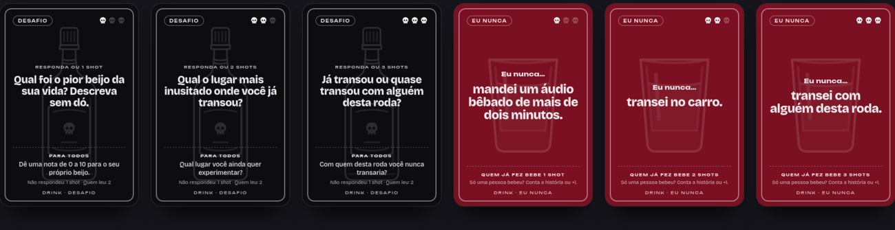
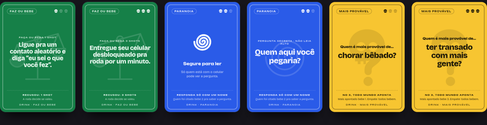
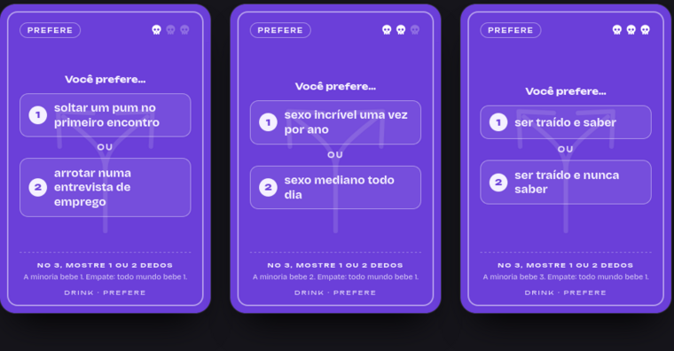
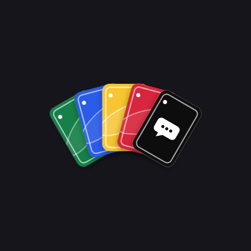

<p align="center">
  
</p>

<p align="center">
  <b>Cartas para a roda de amigos.</b><br>
  Puxe uma carta, puxe assunto. Ou puxe um shot.
</p>

<p align="center">
  <a href="https://github.com/PirataZang/Spill/releases/latest"></a>
  <a href="https://github.com/PirataZang/Spill/actions/workflows/build.yml"></a>
  
  <a href="LICENSE"></a>
</p>

<p align="center">
  <a href="#o-que-é">O que é</a> ·
  <a href="#spill-conversa">Conversa</a> ·
  <a href="#modo-drink-18-jogos-de-shot">Jogos de shot</a> ·
  <a href="#baixar-e-instalar">Baixar</a> ·
  <a href="#para-quem-desenvolve">Desenvolvimento</a>
</p>

---

## O que é

O **Spill** é um app de cartas feito para **juntar gente**. A ideia é simples: deixar o celular de lado como distração e usá-lo como **pretexto para conversar, rir e se conhecer melhor** numa mesa, num churrasco, numa viagem ou numa resenha de sexta.

Ele tem dois lados:

|  | 💬 **Spill, a conversa** | 🥃 **Modo Drink +18, os jogos de shot** |
|---|---|---|
| **Para quê** | Quebrar o gelo e puxar assunto de verdade | Animar a noite com jogos de bebida |
| **Como** | Cartas de filmes, séries, músicas e temas, em 5 baralhos coloridos | 6 jogos com níveis de intensidade e escala de shots |
| **Clima** | Leve, de qualquer idade | Só para maiores de 18 |
| **Cartas** | 100, em português e inglês | 1.200, em português |

Sem cadastro, sem internet, sem anúncio. Abriu, escolheu, jogou.

---

## Spill, conversa

Uma conversa de verdade começa com uma boa pergunta. Cada carta traz uma: *"Quem foi o chefe ou professor mais difícil que você já teve?"*, *"Você pode visitar um ano, do passado ou do futuro. Qual escolhe?"*, *"Qual foi o seu momento mais vergonhoso na escola?"*

<p align="center">
  
</p>

### Como se joga

1. **Escolha um modo.** *Aleatório* mistura todos os baralhos. *Temático* fica numa cor só, e a rodada inteira tem o mesmo clima.
2. **Leia a carta em voz alta** e fale por mais ou menos um minuto.
3. **Continue a conversa.** Todo mundo pode fazer perguntas ou entrar com a própria história.
4. **Próxima carta.** Arraste a carta para qualquer lado da tela, ou toque em *Próxima*.
5. **Pontos, se quiserem.** Depois de cada resposta, o grupo dá um ponto para a mais criativa. Ninguém ganha de verdade.

### Os cinco baralhos

| Cor | Baralho | Clima |
|---|---|---|
| 🟢 Verde | **Dia a Dia** | Escola, trabalho, faculdade e histórias da vida |
| 🔵 Azul | **E Se…** | Apocalipse, outros planetas, superpoderes |
| 🟡 Amarelo | **Conquistas** | Vitórias, sonhos e lugares que você quer conhecer |
| 🔴 Vermelho | **Romance** | Amor, primeiros encontros, crushes |
| ⚫ Preto | **Cringe** | Micos, vergonhas e comédia pura |

O idioma muda no topo da tela, entre **PT** e **EN**.

---

## Modo Drink +18, jogos de shot

Um segundo app dentro do app, **só para maiores de 18**, com visual próprio: fundo escuro e **uma cor e um ícone para cada jogo**. Antes de abrir, pede a confirmação de idade.

### Os 6 jogos

| | Jogo | Em uma frase | Como funciona |
|---|---|---|---|
| ⚫ | **Desafio** | Responde ou bebe | Alguém lê a carta e responde. Quem não quiser, bebe. Depois vem o **"Para todos"**: a roda inteira responde, e quem fugir bebe 1 (quem leu a carta bebe 2). |
| 🍷 | **Eu nunca** | Quem já fez, bebe | A carta diz algo que alguém pode já ter feito. Quem já fez, assume e bebe. Só uma pessoa bebeu? Ela conta a história ou bebe +1. |
| 🟢 | **Faz ou bebe** | Faz a ação ou bebe | A carta pede uma ação, de imitar alguém a entregar o celular desbloqueado. Ou faz, ou bebe. A roda decide se valeu. |
| 🔵 | **Paranoia** | Pergunta secreta | A pergunta fica escondida: quem está com o celular **segura a carta para ler** e responde só com um nome. O citado bebe para saber a pergunta. |
| 🟡 | **Mais provável** | A roda aponta | "Quem é mais provável de…?" No 3, todo mundo aponta ao mesmo tempo. O mais apontado bebe. |
| 🟣 | **Prefere** | A minoria bebe | Duas opções, uma escolha difícil. No 3, todo mundo mostra **1 ou 2 dedos**. A minoria bebe. Empate: todo mundo bebe 1. |

E o **Misturado**, que alterna Desafio e Eu nunca, uma carta de cada.

<p align="center">
  
</p>
<p align="center">
  
</p>
<p align="center">
  
</p>

### Quanto se bebe

Cada carta tem de uma a três **caveiras**: é o nível, e **cada caveira vale 1 shot**.

| Nível | Nome | Caveiras | Valor | Cartas por jogo |
|:---:|---|:---:|:---:|:---:|
| 1 | **Mico** | 💀 | 1 shot | 50 |
| 2 | **Picante** | 💀💀 | 2 shots | 100 |
| 3 | **Pesado** | 💀💀💀 | 3 shots | 50 |

São **200 cartas por jogo**, **1.200 no total**, sem repetir enunciado.

### Monte a rodada

Antes de começar, a tela de configuração deixa você ajustar tudo:

- **Jogo:** uma fila deslizável com os 6 jogos e o Misturado.
- **Níveis:** quais entram na rodada (pelo menos um fica sempre ligado).
- **Escalada:** a rodada começa no mico e esquenta até o pesado. Desligada, as cartas vêm embaralhadas.
- **Modo leve:** **gole** em vez de shot, para a noite durar.

O botão **Começar** mostra quantas cartas a rodada terá, e o botão **?** ao lado do +18 abre o **Como jogar** do jogo escolhido, a qualquer momento.

> **Só para maiores de 18.** Ninguém é obrigado a responder: é para isso que existe o shot. Beba com responsabilidade e nunca dirija depois de beber.

---

## Baixar e instalar

1. Abra a página de [**Releases**](https://github.com/PirataZang/Spill/releases/latest) e baixe o **`Spill.apk`**.
2. No celular Android (8.0 ou mais novo), abra o arquivo. Se o Android pedir, libere *instalar apps desconhecidos* para o navegador ou gerenciador de arquivos.
3. Abra o **Spill** e escolha como jogar.

Cada versão publicada já traz o APK. O app não pede permissão nenhuma e funciona totalmente offline.

---

## Para quem desenvolve

Android nativo, em **Kotlin + Jetpack Compose**, sem nenhuma biblioteca de terceiros além das do Android. Todo o conteúdo é **dado**, não código, então crescer o jogo é só editar JSON.

### Adicionar conteúdo

Tudo vive em [`app/src/main/assets/catalog`](app/src/main/assets/catalog). **Acrescentar uma pergunta não exige mexer em código Kotlin.**

```
catalog/
├── index.json          # idiomas e ordem dos baralhos de conversa
├── i18n/en.json        # textos da interface, um arquivo por idioma
├── i18n/pt.json
├── decks/green.json    # baralho de conversa: cor, nome por idioma e as cartas
└── drink.json          # jogos de shot: as cartas e os textos de regras
```

**Conversa: nova carta.** Acrescente um objeto ao array `cards` do baralho. O número da carta é a posição no array.

```json
{
  "kind": "Movie",
  "by": "Opcional: artista, para o tipo Song",
  "en": { "title": "Ratatouille", "prompt": "What dish can you cook well?" },
  "pt": { "title": "Ratatouille", "prompt": "Que prato você sabe fazer bem?" }
}
```

`kind` é uma chave traduzida em `i18n/*.json` (`Movie`, `Series`, `Song`, `Topic`). **Novo baralho:** crie `decks/<id>.json` e liste o `<id>` em `index.json`. **Novo idioma:** crie `i18n/<codigo>.json`, declare-o em `index.json` e traduza cada carta.

**Jogos de shot: nova carta.** `drink.json` tem um array por jogo (`dare`, `never`, `doit`, `paranoia`, `likely`, `prefer`). Basta um objeto:

```json
{ "level": 2, "main": "Já fingiu orgasmo? Por quê?", "all": "Quanto tempo você aguenta sem sexo? Seja honesto." }
```

- `level`: de 1 a 3, o número de caveiras.
- `main`: o texto. Em *Eu nunca* completa "Eu nunca…"; em *Mais provável*, "Quem é mais provável de…".
- `all`: só no **Desafio**, a pergunta do "Para todos".
- **Prefere** usa `a` e `b` no lugar de `main`: as duas opções.

### Validação

Os testes rodam no CI e **falham o build** se algo sair do padrão, então nada incompleto chega ao jogador:

- `CatalogTest`: toda carta, baralho e tipo tem texto em todos os idiomas.
- `DrinkTest`: 200 cartas por jogo na divisão 50/100/50, sem enunciados repetidos, todos os textos de interface e de regras presentes, e a montagem da rodada (níveis, Escalada, alternância do Misturado).

### Rodar e gerar o APK

Requer JDK 21 e Android SDK (compileSdk 37).

```bash
./gradlew testDebugUnitTest   # valida o catálogo e os jogos de shot
./gradlew assembleRelease     # app/build/outputs/apk/release/app-release.apk
./gradlew installDebug        # instala no aparelho ou emulador conectado
```

### Build e release automáticos

[`.github/workflows/build.yml`](.github/workflows/build.yml) roda em cada push, PR e tag `v*`:

- roda os testes e gera o **`Spill.apk`**, disponível como artefato da execução (`Spill-Android`);
- numa tag `v2.0.0`, o app assume a versão **2.0.0** e o `Spill.apk` é **anexado à Release**;
- com os secrets `KEYSTORE_BASE64`, `KEYSTORE_PASSWORD`, `KEY_ALIAS` e `KEY_PASSWORD`, o APK é assinado com a sua chave; sem eles, usa a chave de debug (instala igual, mas não serve para a Play Store).

### Estrutura

```
app/src/main/java/app/spill/
├── Catalog.kt        # carrega e valida o catálogo de conversa
├── MainActivity.kt   # ViewModel (estado da rodada, idioma), navegação e brilho ambiente
├── Home.kt           # logo em leque, modos e seleção de cor
├── Logo.kt           # o logo animado
├── Game.kt           # baralho empilhado (DeckStage), arrastar/jogar a carta, fim do baralho
├── Rules.kt          # diálogo de regras do modo de conversa
├── Drink.kt          # catálogo dos jogos de shot e montagem da rodada
├── DrinkUi.kt        # confirmação +18, configuração, cartas, Paranoia e regras
├── DrinkArt.kt       # garrafa, copo, balança, espiral, caveira e bifurcação
└── Ui.kt, Theme.kt   # botões, tipografia e o ornamento das cartas
```

Veja o [CHANGELOG](CHANGELOG.md) para o histórico de versões.

---

<p align="center">
  <br>
  <sub>Feito para juntar gente. Licença <a href="LICENSE">MIT</a>.</sub>
</p>
